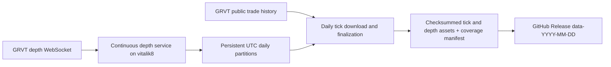

# GRVT daily tick and depth archive design

## Intent and current state

Requested: inspect the Apex historical-data setup, collect GRVT trades/ticks and order-book depth on **vitalik8**, and store the data as GitHub Release assets.

**Design status: approved by the user on 2026-10-16.** No collector, schedule, release, or production configuration has been installed or changed.

## Inspection evidence — 2026-10-16 UTC

| Check | Result |
|---|---|
| Execution host | Local hostname is `vitalik8`; Traycer also lists it as connected |
| Destination | `Ankvik-Tech-Labs/GRVT-Historical-Data`, private, default branch `main`; authenticated account has push/admin access |
| Existing GRVT implementation | Only `README.md`, initial commit `060a7ed` |
| Apex reference revision | GitHub HEAD `c1602f057b22b68caebde8109c269fcdc769143e` |
| Apex server configuration | Docker Compose defines continuous trades and depth services with persistent storage and restart policies |
| Apex server publishing | Publisher selects `--datasets trades`, sleeps 86400 seconds between runs, and does not select depth |
| Apex scheduled release | GitHub Actions workflow at 02:00 UTC, selects klines/funding/ticker; latest three runs succeeded |
| Apex latest release | `data-2026-10-16` contains no assets matching `trades` or `depth` |
| Apex on this host | No matching collector process, Docker container (including stopped), user service, or system timer found in inspected locations; this does not establish deployment state on other hosts |
| GRVT instrument probe | Keyless production `POST /full/v1/instruments`, active perpetual filter, returned 184 instruments, including equities |
| GRVT tick probe | Production `POST /full/v1/trade_history` returned BTC trades and a pagination cursor |
| GRVT depth probe | A 12-second BTC subscription to `v1.book.d` at 100 ms received 111 messages, starting with a sequence-zero snapshot containing 128 bid and 101 ask levels |
| GRVT depth sequence evidence (2026-10-16, repairs B2) | A ~4.5-minute capture of BTC (liquid) and AAOI (quiet equity) on `v1.book.d`, with a forced reconnect, recorded 3030 post-snapshot deltas across both instruments and sessions with zero sequence gaps/duplicates; derived the exact gap predicate, confirmed sequences are per-instrument and session-scoped, and that quiet instruments go up to 4.4s silent with no fault. Evidence: `tests/fixtures/depth_protocol/`. See "Depth sequence protocol" in Collection contract |
| GRVT trade-stream probe | Subscription acknowledged; received 50 initial trade snapshot messages. This short probe does not establish sustained live-trade coverage |
| Available storage | Approximately 119 GiB free on the host filesystem at inspection time; full-universe depth volume still needs measurement before continuous rollout (see "Retention and disk budget" — the measured rollout gate) |

Reference code: [Apex Compose](https://github.com/tradingstrategy-ai/Apex-Historical-Data/blob/c1602f057b22b68caebde8109c269fcdc769143e/docker/docker-compose.daemon.yml), [Apex scheduled workflow](https://github.com/tradingstrategy-ai/Apex-Historical-Data/blob/c1602f057b22b68caebde8109c269fcdc769143e/.github/workflows/release-data.yml), [latest inspected release](https://github.com/tradingstrategy-ai/Apex-Historical-Data/releases/tag/data-2026-10-16).

## Selected approach

Use GRVT's historical trade API for the daily tick archive and run a continuous depth collector. GRVT documents three months of public trade retention and cursor pagination. Its depth delta feed supplies an initial full snapshot and subsequent price-level changes, with zero-size levels representing deletion. This gives daily ticks a recovery path while depth coverage starts with live capture.

| Option | Benefit | Cost / limitation |
|---|---|---|
| **Daily historical ticks + continuous depth — recommended** | Complete dated trade downloads can be retried; one persistent streaming subsystem | Ticks arrive in the archive after the daily job |
| Continuous trades and depth + historical tick reconciliation | Immediate local ticks as well as daily archives | Extra stream lifecycle and reconciliation machinery |
| Daily REST trades and sampled depth snapshots | Simplest runtime | Loses depth changes between snapshots; does not meet the proposed depth-history requirement |

Sources: [GRVT trade history](https://api-docs.grvt.io/market_data_api/#trade-history), [GRVT depth streams](https://api-docs.grvt.io/market_data_streams/#orderbook-delta).

## Available GRVT datasets (reference inventory — current scope unchanged)

The user supplied `https://api-docs.grvt.io/market_data_api/` as the authoritative reference and noted GRVT exposes more than ticks and depth. This table is read-only research context for future scoping decisions; **it does not expand what this plan collects.** Collection stays limited to actual trade ticks (`trade_history`) and full L2 depth (`v1.book.d`) as approved.

| Dataset | REST endpoint / WS stream | Pagination / rate | Retention / backfill |
|---|---|---|---|
| Instruments | `full/v1/{instrument,all_instruments,instruments}` | `instruments` limit default 500, max 100000 | Point-in-time; no history |
| Currency / supported assets / margin rules / collateral info | `full/v1/{currency,supported_assets,margin_rules,get_all_collateral_asset_info}` | N/A | Point-in-time |
| Ticker (REST, do-not-poll) | `full/v1/{mini,ticker}` | Single value | Current only |
| Orderbook levels (REST, do-not-poll) | `full/v1/book` | Max depth 10 | Current only |
| Recent trades (REST) | `full/v1/trade` | limit default 500, max 1000 | Recent only, no cursor |
| **Trade history (collected)** | `full/v1/trade_history` | Reverse-chronological from `end_time`, `cursor`-paginated, limit default 500/max 1000 | **Documented 3-month retention** |
| Candlestick | `full/v1/kline` | Same reverse-chronological/cursor pattern, limit default 500/max 1000 | "As far back as data retention policy allows" — no explicit bound documented |
| Funding rate | `full/v1/funding` | Same reverse-chronological/cursor pattern, `agg_type` aggregation option | Same undocumented-bound retention as candlesticks |
| Settlement | Listed in the docs navigation | Not located under Market Data API during this inspection; likely Trading API / authenticated scope | Not probed |
| Ticker streams | `v1.mini.s`/`v1.mini.d`, `v1.ticker.s`/`v1.ticker.d` | Snapshot-then-delta, rates 50–5000 ms | Live only |
| **Orderbook streams (collected)** | `v1.book.s` (snapshot-per-feed), `v1.book.d` (snapshot + deltas, **used**) | Delta rates 50/100/500/1000 ms | Live only |
| Public trade stream | `v1.trade` | Snapshot-then-delta | Live only |
| Candlestick stream | `v1.candle` | Per-interval | Live only |

Notable finding for B2: the published docs show the subscribe ACK's `first_sequence_number`/`latest_sequence_number` fields only by JSON example, with no prose definition of their semantics or the gap predicate for any delta stream. That absence of a documented rule is why the "Depth sequence protocol" below is derived from a live capture rather than from the reference.

## Collection contract

- **Universe:** all active GRVT perpetual instruments, including crypto and equities; automatically discover additions. The collector persists the per-day discovery record (instruments seen that UTC day); `day_universe` reads that record so a market delisted before the daily download still appears in that day's collection universe.
- **Ticks:** actual public executions, preserving trade ID, instrument, venue, nanosecond exchange timestamp, price, size, and taker side. At 00:30 UTC, download the previous UTC day through all history pages, bounded only by the day's own `[start_time, end_time)`; there is no dependency on when collection activated (REST trade history is retrievable for any date within GRVT's three-month window regardless of local collector uptime). `trade_history` paginates **reverse-chronologically from `end_time` toward `start_time`** using a `cursor` (confirmed from the published API reference, not assumed); `limit` defaults to 500 and has a documented max of 1000. Deduplicate by instrument/trade ID; use explicit UTC bounds and filter the output to the target day. Resume failed dates and report failures per instrument. Record per-instrument page and row counts, and confirm completion by cursor exhaustion *and* the oldest page's timestamp reaching the window **start** — not the end, since pagination walks backward — a returned page is not evidence of completeness by itself.
- **Depth:** full aggregated L2 order book via `v1.book.d`, default 100 ms publishing interval, selectors `<instrument>@100`, subscribed production host `wss://market-data.grvt.io/ws/full`. This archives the exchange's published feed; the rate is not a promise to observe every matching-engine transition.
- **Depth sequence protocol (evidence-based):** captured 2026-10-16 from production (`tests/fixtures/depth_protocol/`, ~4.5 minutes, BTC + the quiet equity AAOI, one forced reconnect; reproduced with `scripts/research/capture_depth_protocol.py` against the `websockets` package already present in an existing unrelated venv — no product dependency was installed anywhere to gather this). Findings, full detail in the fixture's README:
  - The subscribe ACK carries parallel `first_sequence_number`/`latest_sequence_number` arrays, one entry per selector; `first_sequence_number == latest_sequence_number + 1` for every instrument observed.
  - The snapshot message's `sequence_number` is the literal sentinel string `"0"`, not a real per-update value.
  - Sequence numbers are per-instrument (per selector), not per-connection: two instruments multiplexed on one socket had unrelated, independently advancing ranges. A gap therefore invalidates only the affected instrument's book, not the whole 20-instrument connection.
  - Within a session, sequences are strictly contiguous per instrument: across 3030 post-snapshot deltas, zero gaps/duplicates/reorderings occurred. **Gap predicate:** track `last_sequence` per `(session_id, instrument)`; the first delta after a snapshot must equal the ACK's `first_sequence_number`; every later delta must equal `last_sequence + 1`; anything else requires a fresh subscribe (new session) and fresh snapshot for that instrument only.
  - Sequence numbers are session-scoped and must never be compared across a reconnect: a forced reconnect produced a *lower* `first_sequence_number` than the prior session's last-seen value seconds earlier. Resync logic must discard the old session's counter entirely and wait for the new ACK + snapshot, never diff across sessions.
  - Zero-size levels are deletions, as already assumed.
  - A quiet instrument (AAOI) went up to 4.4s between messages with no fault, confirming per-instrument silence is not a valid stall signal (see Replay, below); liveness must come from WebSocket ping/pong.
- **Replay:** save the initial snapshot, ordered deltas, connection/session identifiers, sequence/previous-sequence values, and receipt timestamps. Sequence breaks trigger a new subscription and snapshot; record the unavailable interval. Liveness (is the socket alive) is judged by WebSocket ping/pong, never by per-instrument message silence, because quiet equities can go many seconds between book changes without any fault. Produce a book checkpoint at UTC day boundaries so each daily archive can start replay without fetching an older release; if the collector is down at 00:00 UTC, no on-time checkpoint exists and the day's replay anchor is instead the first snapshot captured that day, with the gap recorded as an outage.
- **First day (activation):** depth before the activation instant is permanently unavailable and labelled as such — it is never fabricated or backfilled by a later run. Ticks are not bounded by activation at all: the activation date's tick download is the same full-day `[00:00, 24:00)` UTC query used for every other day (subject to `end_ns` truncation only when the date being processed has not finished yet, e.g. the same-day activation proof release). This removes the need for any `start_ns` parameter on the trade downloader and removes the spec/plan disagreement that B1 identified: ticks are never windowed to match depth's activation cutoff. Older tick backfill (before the activation date) remains a separate optional operation.

## Storage and publication



- Python package and CLI in this repo; Docker Compose for continuous collection and a host cron wrapper for the fixed UTC daily download/publish job, following the existing host's scheduling conventions.
- Stable deployment checkout at `/home/avik/GRVT-Historical-Data`; persistent runtime data under a dedicated GRVT data directory outside the implementation worktree, at `/home/avik/.local/share/grvt-historical-data`.
- Append-only compressed raw depth segments, with atomic closure and daily normalized Parquet outputs for trades and depth. Each raw segment is a sequence of self-delimited frames (length prefix + CRC); recovery after a crash reads frames until the first invalid one and truncates there, recording an outage for the discarded tail rather than silently losing or fabricating continuity. Preserve numeric strings and nanosecond integers without floating-point conversions. Package closed segments only.

### Sealed staging, manifest revisions, and corrections (resolves B1, B3, B4)

A capture date accumulates **manifest revisions**, numbered from 1. A revision is built once into a **sealed staging bundle**: final Parquet partitions, tar/gzip parts, and a per-asset SHA-256 computed and written to a journal file *before* any upload begins. Builds are made deterministic so a rebuild (if ever needed before journaling) is byte-identical: tar entries sorted by path with fixed mtime/uid/gid, a fixed gzip `mtime=0`, and pinned PyArrow writer settings (fixed compression codec, sorted row groups, pinned Arrow version). Once journaled, a part is never rebuilt — publication (including retries) only ever uploads the exact sealed bytes recorded in the journal.

- **Immutability:** a part file or manifest that has reached a **published** (non-draft) release is never overwritten, replaced, or deleted. A correction — more data for an already-published date, a superset of a window, or a re-partitioned rebuild — is published as the *next* revision: new asset names `grvt-<dataset>-<date>-rev<NN>-part<MM>.tar.gz`, a frozen `manifest-rev<NN>.json`, and a re-uploaded `manifest.json` pointer that is the only asset allowed to be replaced each revision (it is a small, non-sealed index, not a dataset asset). `manifest.json` lists every revision's assets and which, if any, an earlier revision's window a later revision supersedes — superseded assets stay on the release; nothing is deleted remotely, ever.
- **Activation-day completion:** revision 1 for the activation date is the same-day proof release (ticks bounded by `end_ns = now`, since the day has not ended; depth from activation up to a forced-rotation cutoff — see Task 2's rotate-now control). Revision 2 is produced automatically by the *next* scheduled daily run (00:30 UTC the following day), which treats the activation date as `yesterday`/pending and reprocesses it: ticks use the normal full-day query (no special casing), and depth finalization seals only the segments that closed *after* revision 1's cutoff (tracked by segment identity, not by re-slicing a time window) — so revision 2 never needs to reopen or reconstruct any already-sealed, already-deleted revision-1 data. No re-queue flag is needed beyond the existing pending/incomplete-dates tracking, because reprocessing "yesterday" is already the daily job's default behavior.
- **Hash mismatch:** while a release is still a draft, a mismatch between the journaled hash and the hash GitHub reports for an uploaded asset deletes and re-uploads that asset from the same sealed bytes (never rebuilds). Once a release is published, a mismatch is never silently corrected — it is surfaced as an error requiring an explicit new revision.
- One release per **capture date**, e.g. `data-2026-10-16` published after 00:30 UTC on October 17, holding one or more revisions as described above. Split archives below 1 GiB.
- Manifest records instrument universe, requested and observed intervals, row counts, depth rate, outages, successful/failed tick downloads, hashes, schema version, collector revision, and per-instrument coverage start/end. A missing instrument or stream cannot be silently called complete.
- Serialize publication with a filesystem lock and an atomic publication journal. Upload to a draft release, verify remote asset content hashes (using a release-API digest if one is exposed; otherwise streaming-hash the remote copy without storing a second local copy), then publish. Retries resume from the journal and reuse the same sealed bytes; interrupted uploads remain recoverable.

### Retention and disk budget (resolves B5; supersedes the earlier seven-day rule)

- **Local retention:** no fixed day-count buffer. A sealed window's staging bytes and the raw/intermediate inputs sealed into it are deleted as soon as — and only as soon as — its containing revision is **published** (not merely drafted) *and* every one of its part hashes has been remote-verified. Currently open (`.open`) segments, any staging directory for a revision that has not finished verified publish, and small operational state (checkpoints, the per-day discovery/universe record, the publication journal, the incomplete-tick retry queue, logs) are never pruned by this rule regardless of age.
- **High-water behavior:** the collector/CLI watch free space on the data root's filesystem. Below 20% free, `status` and logs report a degraded warning. Below 10% free (or 10 GiB, whichever is larger), the daily job immediately runs verified cleanup ahead of schedule and the collector stops growing the subscribed universe (it keeps capturing already-subscribed instruments) until free space recovers above the warning line. Below 2 GiB free, the collector flushes and cleanly closes its current open segments and exits non-zero rather than risk a corrupt partial write; it never silently drops data to keep running.
- **Measured rollout gate:** before the daily cron block is installed (Task 5), run the collector against the full discovered universe for a measured 1–2 hour window and record observed raw bytes/sec, projected bytes/day, per-instrument rate outliers, and the compression ratio from one sealed build. Only install the cron block if a projected full UTC day of raw segments for the whole universe, assuming zero publishes that day, stays under 50% of the data root filesystem's free space at measurement time; otherwise reduce scope or add storage first. This replaces "measure after deployment" with a go/no-go check before continuous rollout is relied upon.
- Keep GitHub releases indefinitely — remote retention is unchanged and remains indefinite.
- Use host GitHub authentication for publication; keep credentials outside Git and outside the streaming collector's environment.

### Deployment paths and schedule (precise)

- Deployment checkout: `/home/avik/GRVT-Historical-Data`; isolated virtualenv at `/home/avik/GRVT-Historical-Data/.venv`.
- Data root: `/home/avik/.local/share/grvt-historical-data`; lock file `/home/avik/.local/share/grvt-historical-data/state/run-daily.lock`; logs under `/home/avik/.local/share/grvt-historical-data/logs/daily.log`, rotated by a `logrotate` drop-in (weekly, keep 8, compressed).
- Daily wrapper: `/home/avik/GRVT-Historical-Data/scripts/run-daily.sh` — sets `PATH`/`HOME` explicitly, invokes the venv's `grvt-data` entry point by absolute path (no reliance on shell activation), runs `daily` then `publish` for pending dates, and propagates the exit code.
- Crontab block, installed/replaced idempotently between named markers, preserving all other existing crontab lines:
  ```
  # BEGIN grvt-data-daily
  CRON_TZ=UTC
  30 0 * * * TZ=UTC flock -n /home/avik/.local/share/grvt-historical-data/state/run-daily.lock /home/avik/GRVT-Historical-Data/scripts/run-daily.sh >> /home/avik/.local/share/grvt-historical-data/logs/daily.log 2>&1
  # END grvt-data-daily
  ```
  `TZ=UTC` is set explicitly in addition to `CRON_TZ=UTC` as a cheap safeguard against a cron daemon that ignores the latter (N3).

## Verification required before calling setup complete

1. Tests cover paginated trade downloads, UTC boundaries, deduplication, sequence breaks, snapshot recovery, day rollover/checkpoint replay, crash recovery, retryable publication, the activation revision-1/revision-2 sequence, a superset/re-partitioned correction, and the disk high-water behavior.
2. Live production smoke capture verifies trades and replayable depth for multiple instruments; a universe-wide run verifies subscription acceptance and actual coverage.
3. A dated release is uploaded, downloaded again, hash-checked, and inspected for both datasets and the coverage manifest. The activation day's permanently-partial pre-activation depth window is explicit in the manifest, not implied as "to be completed."
4. Confirm persistent service restart behavior, cron installation, daily command success, logs/status, and the measured rollout gate's pass/fail result on vitalik8 before relying on continuous unattended operation.

## Approved scope

The user approved: **all active perpetuals; daily historical ticks; continuous full L2 depth at 100 ms; previous-day releases at 00:30 UTC; indefinite remote retention.** Local retention is superseded from "seven days of verified data" to **immediate deletion of sealed, hash-verified, published local data only**, preserving open segments, unpublished/unverified staging, and small operational state (see "Retention and disk budget" above). Implementation has not started; this document and the implementation plan were repaired against an independent plan review (`artifacts/grvt-plan-review`) before Task 1 begins.
