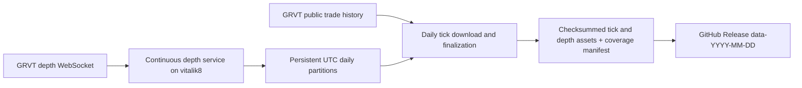

# GRVT daily tick and depth archive design

## Intent and current state

Requested: inspect the Apex historical-data setup, collect GRVT trades/ticks and order-book depth on **vitalik8**, and store the data as GitHub Release assets.

**Design status: approved by the user on 2026-10-16.** No collector, schedule, release, or production configuration has been installed or changed.

## Inspection evidence — 2026-10-16 UTC

| Check | Result |
|---|---|
| Execution host | Local hostname is `vitalik8`; Traycer also lists it as connected |
| Destination | `Ankvik-Tech-Labs/GRVT-Historical-Data`, private, default branch `main`; authenticated account has push/admin access |
| Existing GRVT implementation | Only `README.md`, initial commit `060a7ed` |
| Apex reference revision | GitHub HEAD `c1602f057b22b68caebde8109c269fcdc769143e` |
| Apex server configuration | Docker Compose defines continuous trades and depth services with persistent storage and restart policies |
| Apex server publishing | Publisher selects `--datasets trades`, sleeps 86400 seconds between runs, and does not select depth |
| Apex scheduled release | GitHub Actions workflow at 02:00 UTC, selects klines/funding/ticker; latest three runs succeeded |
| Apex latest release | `data-2026-10-16` contains no assets matching `trades` or `depth` |
| Apex on this host | No matching collector process, Docker container (including stopped), user service, or system timer found in inspected locations; this does not establish deployment state on other hosts |
| GRVT instrument probe | Keyless production `POST /full/v1/instruments`, active perpetual filter, returned 184 instruments, including equities |
| GRVT tick probe | Production `POST /full/v1/trade_history` returned BTC trades and a pagination cursor |
| GRVT depth probe | A 12-second BTC subscription to `v1.book.d` at 100 ms received 111 messages, starting with a sequence-zero snapshot containing 128 bid and 101 ask levels |
| GRVT depth sequence evidence (2026-10-16, repairs B2/K5) | A ~4.5-minute capture of BTC (liquid) and AAOI (quiet equity) on `v1.book.d` — session 1 (~4 min) plus a forced-reconnect session 2 (~30s) — recorded 3030 post-snapshot deltas with zero sequence gaps/duplicates across both sessions; derived the exact gap predicate, confirmed sequences are per-instrument within a session and never comparable across a reconnect, and that quiet instruments go up to 4.4s silent with no fault. The capture evidences only connection-level reconnect, not per-selector resubscribe; the depth protocol below adopts whole-connection resync accordingly (K5). Evidence: `tests/fixtures/depth_protocol/` — full capture committed, gzipped. See "Depth sequence protocol" in Collection contract |
| GRVT trade-stream probe | Subscription acknowledged; received 50 initial trade snapshot messages. This short probe does not establish sustained live-trade coverage |
| Available storage | Approximately 119 GiB free on the host filesystem at inspection time; full-universe depth volume still needs measurement before continuous rollout (see "Retention and disk budget" — the measured rollout gate) |

Reference code: [Apex Compose](https://github.com/tradingstrategy-ai/Apex-Historical-Data/blob/c1602f057b22b68caebde8109c269fcdc769143e/docker/docker-compose.daemon.yml), [Apex scheduled workflow](https://github.com/tradingstrategy-ai/Apex-Historical-Data/blob/c1602f057b22b68caebde8109c269fcdc769143e/.github/workflows/release-data.yml), [latest inspected release](https://github.com/tradingstrategy-ai/Apex-Historical-Data/releases/tag/data-2026-10-16).

## Selected approach

Use GRVT's historical trade API for the daily tick archive and run a continuous depth collector. GRVT documents three months of public trade retention and cursor pagination. Its depth delta feed supplies an initial full snapshot and subsequent price-level changes, with zero-size levels representing deletion. This gives daily ticks a recovery path while depth coverage starts with live capture.

| Option | Benefit | Cost / limitation |
|---|---|---|
| **Daily historical ticks + continuous depth — recommended** | Complete dated trade downloads can be retried; one persistent streaming subsystem | Ticks arrive in the archive after the daily job |
| Continuous trades and depth + historical tick reconciliation | Immediate local ticks as well as daily archives | Extra stream lifecycle and reconciliation machinery |
| Daily REST trades and sampled depth snapshots | Simplest runtime | Loses depth changes between snapshots; does not meet the proposed depth-history requirement |

Sources: [GRVT trade history](https://api-docs.grvt.io/market_data_api/#trade-history), [GRVT depth streams](https://api-docs.grvt.io/market_data_streams/#orderbook-delta).

## Available GRVT datasets (reference inventory — current scope unchanged)

The user supplied `https://api-docs.grvt.io/market_data_api/` as the authoritative reference and noted GRVT exposes more than ticks and depth. This table is read-only research context for future scoping decisions; **it does not expand what this plan collects.** Collection stays limited to actual trade ticks (`trade_history`) and full L2 depth (`v1.book.d`) as approved.

| Dataset | REST endpoint / WS stream | Pagination / rate | Retention / backfill |
|---|---|---|---|
| Instruments | `full/v1/{instrument,all_instruments,instruments}` | `instruments` limit default 500, max 100000 | Point-in-time; no history |
| Currency / supported assets / margin rules / collateral info | `full/v1/{currency,supported_assets,margin_rules,get_all_collateral_asset_info}` | N/A | Point-in-time |
| Ticker (REST, do-not-poll) | `full/v1/{mini,ticker}` | Single value | Current only |
| Orderbook levels (REST, do-not-poll) | `full/v1/book` | Max depth 10 | Current only |
| Recent trades (REST) | `full/v1/trade` | limit default 500, max 1000 | Recent only, no cursor |
| **Trade history (collected)** | `full/v1/trade_history` | Reverse-chronological from `end_time`, `cursor`-paginated, limit default 500/max 1000 | **Documented 3-month retention** |
| Candlestick | `full/v1/kline` | Same reverse-chronological/cursor pattern, limit default 500/max 1000 | "As far back as data retention policy allows" — no explicit bound documented |
| Funding rate | `full/v1/funding` | Same reverse-chronological/cursor pattern, `agg_type` aggregation option | Same undocumented-bound retention as candlesticks |
| Settlement | Listed in the docs navigation | Not located under Market Data API during this inspection; likely Trading API / authenticated scope | Not probed |
| Ticker streams | `v1.mini.s`/`v1.mini.d`, `v1.ticker.s`/`v1.ticker.d` | Snapshot-then-delta, rates 50–5000 ms | Live only |
| **Orderbook streams (collected)** | `v1.book.s` (snapshot-per-feed), `v1.book.d` (snapshot + deltas, **used**) | Delta rates 50/100/500/1000 ms | Live only |
| Public trade stream | `v1.trade` | Snapshot-then-delta | Live only |
| Candlestick stream | `v1.candle` | Per-interval | Live only |

Notable finding for B2: the published docs show the subscribe ACK's `first_sequence_number`/`latest_sequence_number` fields only by JSON example, with no prose definition of their semantics or the gap predicate for any delta stream. That absence of a documented rule is why the "Depth sequence protocol" below is derived from a live capture rather than from the reference.

## Collection contract

- **Universe:** all active GRVT perpetual instruments, including crypto and equities; automatically discover additions. The collector persists the per-day discovery record (instruments seen that UTC day); `day_universe` reads that record so a market delisted before the daily download still appears in that day's collection universe.
- **Ticks:** actual public executions, preserving trade ID, instrument, venue, nanosecond exchange timestamp, price, size, and taker side. At 00:30 UTC, download the previous UTC day through all history pages, bounded only by the day's own `[start_time, end_time)`; there is no dependency on when collection activated (REST trade history is retrievable for any date within GRVT's three-month window regardless of local collector uptime). `trade_history` paginates **reverse-chronologically from `end_time` toward `start_time`** using a `cursor` (confirmed from the published API reference, not assumed); `limit` defaults to 500 and has a documented max of 1000. Deduplicate by instrument/trade ID; use explicit UTC bounds and filter the output to the target day. Resume failed dates and report failures per instrument. Record per-instrument page and row counts, and confirm completion by cursor exhaustion *and* the oldest page's timestamp reaching the window **start** — not the end, since pagination walks backward — a returned page is not evidence of completeness by itself.
- **Depth:** full aggregated L2 order book via `v1.book.d`, default 100 ms publishing interval, selectors `<instrument>@100`, subscribed production host `wss://market-data.grvt.io/ws/full`. This archives the exchange's published feed; the rate is not a promise to observe every matching-engine transition.
- **Depth sequence protocol (evidence-based, K4/K5 corrected):** captured 2026-10-16 from production (`tests/fixtures/depth_protocol/`, ~4.5 minutes across two sessions, BTC + the quiet equity AAOI, one forced reconnect; reproduced with `scripts/research/capture_depth_protocol.py` against the `websockets` package already present in an existing unrelated venv — no product dependency was installed anywhere to gather this). The full capture (not a trimmed subset) is committed, gzipped; every number below is verifiable against it. Findings, full detail in the fixture's README:
  - The subscribe ACK carries parallel `first_sequence_number`/`latest_sequence_number` arrays, one entry per selector; `first_sequence_number == latest_sequence_number + 1` for every instrument observed, within one session (never compare across sessions — see below).
  - The snapshot message's `sequence_number` is the literal sentinel string `"0"`, not a real per-update value.
  - Sequence numbers are per-instrument (per selector): two instruments multiplexed on one socket had unrelated, independently advancing ranges.
  - Within a session, sequences are strictly contiguous per instrument: across all 3030 post-snapshot deltas (2106+253 BTC, 588+83 AAOI across the two sessions), zero gaps/duplicates/reorderings occurred.
  - **What this capture does *not* evidence:** a per-instrument resubscribe on an otherwise-live multi-instrument socket. The only resync behavior actually observed is a full connection close followed by a brand-new `subscribe` naming every selector again. **Design decision (K5): resync is scoped to the whole connection, not the instrument.** On any sequence gap for any instrument on a connection, close that connection, open a new one with a new connection id, subscribe every selector again, and require a fresh ACK + fresh snapshot for each one before accepting its deltas. Record an outage for *every* instrument that was on the reconnected connection, not just the one that gapped. A delta for an instrument that arrives before that instrument's own post-reconnect snapshot is a protocol violation and forces another reconnect. This costs extra reconnects/snapshots for unaffected peer instruments on the same connection; that cost is accepted in exchange for only ever implementing evidenced behavior — a narrower per-selector live resubscribe is explicitly not implemented because nothing demonstrates its ACK/session semantics.
  - **Gap predicate:** `session_id` is the identity of a connection's subscribe ACK (one ACK, one `session_id`, covers every selector subscribed on that connection — not a per-instrument value). Track `last_sequence` per `(session_id, instrument)`; the first delta after a snapshot must equal that ACK's `first_sequence_number` for the instrument; every later delta must equal `last_sequence + 1`; anything else is a gap and triggers the whole-connection reconnect above.
  - Sequence numbers are session-scoped and must never be compared across a reconnect: a forced reconnect produced a BTC `first_sequence_number` (933302) far *lower* than the prior session's last-seen value (967039) seconds earlier. Resync logic must discard the old session's counters entirely and wait for the new connection's ACK + snapshot, never diff across sessions.
  - Pre-snapshot delta ordering (buffer vs. discard) was never actually exercised — in both captured sessions the snapshot was the first message after the ACK. The protocol-violation rule above is a deliberate design choice for the unobserved case, not an empirical finding.
  - Zero-size levels are deletions, as already assumed.
  - A quiet instrument (AAOI) went up to 4.4s between messages with no fault, confirming per-instrument silence is not a valid stall signal (see Replay, below); liveness must come from WebSocket ping/pong.
- **Replay:** save the initial snapshot, ordered deltas, connection/session identifiers, sequence/previous-sequence values, and receipt timestamps. A sequence break reconnects the whole connection and resubscribes every selector on it (see "Depth sequence protocol"); record the unavailable interval for every affected instrument. Liveness (is the socket alive) is judged by WebSocket ping/pong, never by per-instrument message silence, because quiet equities can go many seconds between book changes without any fault. Produce a book checkpoint at UTC day boundaries, serialized through the same book-apply loop that processes deltas (never a concurrent snapshot of in-flight state), so each daily archive can start replay without fetching an older release; if the collector is down at 00:00 UTC, no on-time checkpoint exists and the day's replay anchor is instead the first snapshot captured that day, with the gap recorded as an outage. A **mid-day checkpoint** (produced by `rotate_now`, see Task 2) carries the same fields as a day-boundary checkpoint plus, per instrument, its current `session_id` and `last_sequence`, so the first post-cutoff segment can continue gap-checking from exactly that state rather than restarting blind.
- **First day (activation):** depth before the activation instant is permanently unavailable and labelled as such — it is never fabricated or backfilled by a later run. Ticks are not bounded by activation at all: the activation date's tick download is the same full-day `[00:00, 24:00)` UTC query used for every other day (subject to `end_time` truncation only when the date being processed has not finished yet, e.g. the same-day activation proof release). This removes the need for any `start_ns` parameter on the trade downloader and removes the spec/plan disagreement that B1 identified: ticks are never windowed to match depth's activation cutoff. The cutoff instant used for `end_time` is never operator-guessed: it is the exact `cutoff_received_ns` that `rotate_now` (Task 2) hands back from the collector's own apply loop, so the trade window and the depth window share one authoritative instant (K4). Older tick backfill (before the activation date) remains a separate optional operation.

## Storage and publication



- Python package and CLI in this repo; Docker Compose for continuous collection and a host cron wrapper for the fixed UTC daily download/publish job, following the existing host's scheduling conventions.
- Stable deployment checkout at `/home/avik/GRVT-Historical-Data`; persistent runtime data under a dedicated GRVT data directory outside the implementation worktree, at `/home/avik/.local/share/grvt-historical-data`.
- Append-only compressed raw depth segments, with atomic closure and daily normalized Parquet outputs for trades and depth. Each raw segment is a sequence of self-delimited frames (length prefix + CRC); recovery after a crash reads frames until the first invalid one and truncates there, recording an outage for the discarded tail rather than silently losing or fabricating continuity. Preserve numeric strings and nanosecond integers without floating-point conversions. Package closed segments only.

### Sealed staging, manifest revisions, and corrections (resolves B1, B3, B4; corrected K1, K2, K3)

A capture date accumulates **manifest revisions**, numbered from 1. A revision is built once into a **sealed staging bundle**: final Parquet partitions, tar/gzip parts, and a per-asset SHA-256 computed and written to a journal file *before* any upload begins. Builds are made deterministic so a rebuild (if ever needed before journaling) is byte-identical: tar entries sorted by path with fixed mtime/uid/gid, a fixed gzip header (`mtime=0`, empty `filename`, a fixed OS byte — not `mtime=0` alone), and pinned PyArrow writer settings (fixed compression codec, sorted row groups, pinned Arrow version). Once journaled, a part is never rebuilt — publication (including retries) only ever uploads the exact sealed bytes recorded in the journal.

- **No mutable pointer asset (K1).** There is no `manifest.json` asset of any kind — a prior draft of this spec proposed one as "the only asset allowed to be replaced," which the re-review correctly flagged: GitHub does not overwrite release assets in place, so "replace" meant delete-then-upload, i.e. a remote delete, with a window where the pointer does not exist. Every uploaded object — each `grvt-<dataset>-<date>-rev<NN>-part<MM>.tar.gz` and each `manifest-rev<NN>.json` — is immutable from the moment it is uploaded: never overwritten, replaced, or deleted, for any revision, published or not.
- **The commit point is the release body, PATCHed exactly once per revision, after verification.** GitHub release metadata (the release's own description/body text) can be edited in place without touching any asset. That text is the single source of truth for "which revision is canonical": `Active revision: <N>, manifest-rev<N>.json, sha256 <hash>`, plus a short human-readable coverage summary. Readers of a release must read the body to find the committed manifest; the presence of an asset on the release is not, by itself, evidence that it is part of the committed archive.
  - **Revision 1** (the release does not exist yet): create a draft release for tag `data-<date>`, upload revision 1's parts and `manifest-rev01.json`, verify every uploaded hash remotely, set the release body to point at revision 1, then publish the draft. Publishing the draft *is* the commit point — nothing was visible before it.
  - **Revision N > 1** (the release is already public): upload revision N's parts and `manifest-revNN.json` as plain new assets on the existing public release — referenced by nothing yet, so their mere presence commits nothing. Verify every one of their hashes remotely. Only then PATCH the release body to point at revision N. If a crash happens after some of revision N's assets are uploaded but before the body PATCH, the body still names revision N-1; the orphaned, unreferenced revision-N assets are harmless and the retry simply re-verifies/re-uploads what's missing and reissues the same PATCH — idempotent, no probe of GitHub's draft-under-an-existing-tag semantics is needed because a second draft is never created.
  - A hash mismatch while a revision's assets are still unreferenced (not yet pointed to by the body) is handled the same way regardless of draft/public: re-upload that one asset from the same sealed bytes, never rebuild. A mismatch discovered *after* the body already points at that revision is never silently corrected — surfaced as an error requiring the next revision.
- **Durable segment ledger and one-unfinished-revision-per-day (K2, K3).** A small SQLite database, `publication.sqlite`, under the data root is the durable ledger — counted as small operational state, never touched by cleanup (see "Retention and disk budget"). Sealing a revision is one SQLite transaction that: reserves the identities of every closed depth segment it is about to seal (so a later seal can never claim the same segment twice, and a seal never needs to re-slice a time window or touch an already-sealed-and-deleted segment), and writes/advances that revision's row through `sealing → sealed → uploading → verified → committed`. **Only one unfinished (non-`committed`) revision is allowed per day.** Sealing revision N+1 for a day is refused while revision N for that day is not yet `committed`; the daily job must finish N (resume uploads, verify, PATCH the body) before a new revision can be sealed for that day. This is the simpler of the two options the re-review offered, chosen explicitly to avoid a second durable-ledger-for-overlap mechanism.
- **The daily job's target-date set is derived from the ledger, not from "pending" left undefined.** Each run processes, oldest first: `yesterday` UTC, **union** every date with a non-`committed` revision row in `publication.sqlite`, **union** every date with depth segments closed on disk but not yet reserved by any revision, **union** every date still in the tick retry queue. This covers the activation day's revision 2, a publish that failed on day D (D's unfinished revision is retried on every later run until it commits, not only on D+1), and a depth segment that closes late (after D was already committed) — which becomes a fresh revision N+1 the next time the job runs, because it shows up as "unreserved closed segments for date D."
- **Activation-day completion is one instance of the general rule above**, not a special case: revision 1 for the activation date is the same-day proof release (ticks bounded by `end_time = now`, since the day has not ended; depth from activation up to the `rotate_now` cutoff — see Task 2 and K4). The next scheduled run finds the activation date via `yesterday` (and, if revision 1 never got to `committed`, via the ledger union too) and seals revision 2 from segments reserved after revision 1's cutoff — never reopening or needing revision-1 data that has already been deleted post-verification.
- One release per **capture date**, e.g. `data-2026-10-16`, holding one or more revisions as described above. Split archives below 1 GiB.
- Each revision's manifest (`manifest-rev<NN>.json`) records instrument universe, requested and observed intervals, row counts, depth rate, outages, successful/failed tick downloads, hashes, schema version, and per-instrument coverage start/end. A missing instrument or stream cannot be silently called complete.
- Serialize publication with a filesystem lock; `publication.sqlite`'s transactions are the atomic record of sealing/upload/verify/commit progress, replacing the separate "publication journal" concept. Verify remote asset content hashes using a release-API digest if one is exposed; otherwise stream-hash the remote copy without storing a second local copy. Retries resume from the ledger and reuse the same sealed bytes; interrupted uploads remain recoverable.

### Retention and disk budget (resolves B5; supersedes the earlier seven-day rule; corrected K7)

- **Local retention:** no fixed day-count buffer. A sealed window's staging bytes and the raw/intermediate inputs sealed into it are deleted as soon as — and only as soon as — its containing revision is **committed** (the release body PATCH has landed, not merely "uploaded") *and* every one of its part hashes has been remote-verified. Currently open (`.open`) segments, any staging directory for a revision that has not reached `committed`, and small operational state (checkpoints, the per-day discovery/universe record, `publication.sqlite` and its WAL file, the incomplete-tick retry queue, logs) are never pruned by this rule regardless of age. **Accepted consequence:** once a revision is committed and locally pruned, GitHub holds the only copy of that window's live-captured depth — there is no second local copy by design, because immediate pruning was explicitly authorized. The restore path for a later re-partitioned correction to an already-pruned window is downloading that window's committed parts back from the release, never re-deriving from local raw (which no longer exists). Hash verification happens once, at commit time; there is no later re-check of already-committed remote bytes.
- **High-water behavior, fractions of total filesystem capacity (not current free space):** the collector/CLI watch the data root filesystem's **total capacity** and current free bytes. Below 20% free-of-total, `status` and logs report a degraded warning. Below 10% free-of-total (or 10 GiB, whichever is larger), the daily job immediately runs verified cleanup ahead of schedule and the collector stops growing the subscribed universe (it keeps capturing already-subscribed instruments) until free space recovers above the warning line. Below 2 GiB free, the collector flushes and cleanly closes its current open segments and exits non-zero rather than risk a corrupt partial write; it never silently drops data to keep running. **The container does not simply restart into the same full-disk condition:** on a hard-stop exit, the collector writes a pause marker with a backoff schedule; on the next start (whether from `unless-stopped` or manual), it checks free space and the marker first — if still below the hard-stop line, it waits out the backoff and re-checks rather than immediately subscribing and exiting again in a restart busy-loop.
- **Measured rollout gate, peak co-resident footprint, before the daily cron block is installed (Task 5):** run the collector against the full discovered universe for a measured 1–2 hour window and record observed raw bytes/sec, projected bytes/day, per-instrument rate outliers, and the compression ratio from one sealed build (Parquet + tar vs. raw). The gate compares **peak co-resident usage**, not raw volume alone, against free space: at 00:30 UTC on day D+1, before day D's revision is committed, disk holds day D's raw segments, D's normalized Parquet, and D's tar parts *simultaneously*, while day D+1's raw is already accruing from 00:00. Gate formula: `day_D_raw + day_D_parquet_and_tar (raw × measured compression ratio) + one_day_raw_accrual (D+1) + publish_delay_reserve`, where `publish_delay_reserve` is a fixed allowance (configurable, default one additional day of raw) for the time a revision can sit uploaded-but-not-yet-committed. Only install the cron block if that peak stays under 50% of the data root filesystem's free space at measurement time; otherwise reduce scope or add storage first. This replaces both "measure after deployment" and the earlier raw-only formula with a go/no-go check before continuous rollout is relied upon.
- Keep GitHub releases indefinitely — remote retention is unchanged and remains indefinite.
- Use host GitHub authentication for publication; keep credentials outside Git and outside the streaming collector's environment.

### Deployment paths and schedule (precise; corrected K6)

- Deployment checkout: `/home/avik/GRVT-Historical-Data`; isolated virtualenv at `/home/avik/GRVT-Historical-Data/.venv`.
- Data root: `/home/avik/.local/share/grvt-historical-data`; lock file `/home/avik/.local/share/grvt-historical-data/state/run-daily.lock`; ledger `/home/avik/.local/share/grvt-historical-data/state/publication.sqlite`; local status file `/home/avik/.local/share/grvt-historical-data/state/status-health.json`; logs under `/home/avik/.local/share/grvt-historical-data/logs/{daily,status}.log`, rotated by a `logrotate` drop-in (weekly, keep 8, compressed).
- Daily wrapper: `/home/avik/GRVT-Historical-Data/scripts/run-daily.sh` — explicitly sets `TZ=UTC` (scoped to this script's own process, not the shared crontab) and `PATH`/`HOME`, invokes the venv's `grvt-data` entry point by absolute path (no reliance on shell activation), runs **`daily` once** (which seals/retries/commits the whole pending-date set itself — see "Sealed staging..." — there is no separate `publish` call from the wrapper), wrapped in `timeout 6h` so a stuck run cannot block forever, and propagates the exit code. `flock -w 60` (not `-n`): a held lock waits up to 60s and then exits non-zero with an explicit "lock held, skipping run" line in the log, instead of exiting silently.
- A **separate, explicitly non-alerting** status cron entry runs every 5 minutes: `grvt-data status --check`, which writes `state/status-health.json` (collector heartbeat, disk high-water tier, retry-queue age, pending/uncommitted revisions) and appends one line to `logs/status.log`. **No external notification mechanism is authorized or wired** — this is a local, pollable status snapshot and log trail, not a delivered alert. Anyone who wants paging must build that separately; this schedule only guarantees the data to page from is current and on disk.
- Crontab block, installed/replaced idempotently between named markers, preserving all other existing crontab lines. `CRON_TZ` is **not** set as a standalone crontab-wide line — on at least some cron implementations that applies to every subsequent line in a *shared* crontab, which would silently change the schedule of pre-existing unrelated entries below the block; this host's actual `CRON_TZ` scoping behavior is unverified, so it is simply not used. `TZ=UTC` is set per job line instead, which cron always scopes to that line only:
  ```
  # BEGIN grvt-data-daily
  30 0 * * * TZ=UTC flock -w 60 /home/avik/.local/share/grvt-historical-data/state/run-daily.lock /home/avik/GRVT-Historical-Data/scripts/run-daily.sh >> /home/avik/.local/share/grvt-historical-data/logs/daily.log 2>&1
  */5 * * * * TZ=UTC /home/avik/GRVT-Historical-Data/.venv/bin/grvt-data status --check >> /home/avik/.local/share/grvt-historical-data/logs/status.log 2>&1
  # END grvt-data-daily
  ```

## Verification required before calling setup complete

1. Tests cover paginated trade downloads, UTC boundaries, deduplication, whole-connection sequence-gap reconnects, snapshot recovery, day rollover/mid-day checkpoint replay, crash recovery, retryable publication, the K1 commit-point sequencing (uploaded-but-uncommitted assets vs. the body pointer), the K2/K3 ledger (one unfinished revision per day, pending-date-set derivation), and the K7 peak-footprint disk gate.
2. Live production smoke capture verifies trades and replayable depth for multiple instruments; a universe-wide run verifies subscription acceptance and actual coverage.
3. A dated release is uploaded, downloaded again, hash-checked against its committed manifest (read from the release body, not assumed from the asset list), and inspected for both datasets. The activation day's permanently-partial pre-activation depth window is explicit in the manifest, not implied as "to be completed."
4. Confirm persistent service restart behavior (including hard-stop backoff, not a restart busy-loop), cron installation (both the daily and status entries), daily command success, local status output, and the measured rollout gate's pass/fail result on vitalik8 before relying on continuous unattended operation.

## Approved scope

The user approved: **all active perpetuals; daily historical ticks; continuous full L2 depth at 100 ms; previous-day releases at 00:30 UTC; indefinite remote retention.** Local retention is superseded from "seven days of verified data" to **immediate deletion of sealed, hash-verified, committed local data only**, preserving open segments, unpublished/unverified staging, and small operational state (see "Retention and disk budget" above). Implementation has not started; this document and the implementation plan were repaired against an independent plan review (`artifacts/grvt-plan-review`), then against a scoped re-review (`artifacts/grvt-plan-rereview`) that found the first repair's revision/publication and disk-gate mechanisms still underspecified — K1 through K7 above are that second round of fixes — before Task 1 begins.
