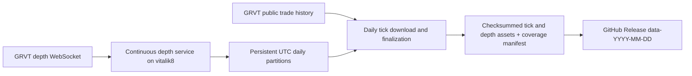

# GRVT daily tick and depth archive design

## Intent and current state

Requested: inspect the Apex historical-data setup, collect GRVT trades/ticks and order-book depth on **vitalik8**, and store the data as GitHub Release assets.

**Design status: approved by the user on 2026-10-16.** No collector, schedule, release, or production configuration has been installed or changed.

## Inspection evidence — 2026-10-16 UTC

| Check | Result |
|---|---|
| Execution host | Local hostname is `vitalik8`; Traycer also lists it as connected |
| Destination | `Ankvik-Tech-Labs/GRVT-Historical-Data`, private, default branch `main`; authenticated account has push/admin access |
| Existing GRVT implementation | Only `README.md`, initial commit `060a7ed` |
| Apex reference revision | GitHub HEAD `c1602f057b22b68caebde8109c269fcdc769143e` |
| Apex server configuration | Docker Compose defines continuous trades and depth services with persistent storage and restart policies |
| Apex server publishing | Publisher selects `--datasets trades`, sleeps 86400 seconds between runs, and does not select depth |
| Apex scheduled release | GitHub Actions workflow at 02:00 UTC, selects klines/funding/ticker; latest three runs succeeded |
| Apex latest release | `data-2026-10-16` contains no assets matching `trades` or `depth` |
| Apex on this host | No matching collector process, Docker container (including stopped), user service, or system timer found in inspected locations; this does not establish deployment state on other hosts |
| GRVT instrument probe | Keyless production `POST /full/v1/instruments`, active perpetual filter, returned 184 instruments, including equities |
| GRVT tick probe | Production `POST /full/v1/trade_history` returned BTC trades and a pagination cursor |
| GRVT depth probe | A 12-second BTC subscription to `v1.book.d` at 100 ms received 111 messages, starting with a sequence-zero snapshot containing 128 bid and 101 ask levels |
| GRVT depth sequence evidence (2026-10-16, repairs B2/K5) | A ~4.5-minute capture of BTC (liquid) and AAOI (quiet equity) on `v1.book.d` — session 1 (~4 min) plus a forced-reconnect session 2 (~30s) — recorded 3030 post-snapshot deltas with zero sequence gaps/duplicates across both sessions; derived the exact gap predicate, confirmed sequences are per-instrument within a session and never comparable across a reconnect, and that quiet instruments go up to 4.4s silent with no fault. The capture evidences only connection-level reconnect, not per-selector resubscribe; the depth protocol below adopts whole-connection resync accordingly (K5). Evidence: `tests/fixtures/depth_protocol/` — full capture committed, gzipped. See "Depth sequence protocol" in Collection contract |
| GRVT trade-stream probe | Subscription acknowledged; received 50 initial trade snapshot messages. This short probe does not establish sustained live-trade coverage |
| Available storage | Approximately 119 GiB free on the host filesystem at inspection time; full-universe depth volume still needs measurement before continuous rollout (see "Retention and disk budget" — the measured rollout gate) |

Reference code: [Apex Compose](https://github.com/tradingstrategy-ai/Apex-Historical-Data/blob/c1602f057b22b68caebde8109c269fcdc769143e/docker/docker-compose.daemon.yml), [Apex scheduled workflow](https://github.com/tradingstrategy-ai/Apex-Historical-Data/blob/c1602f057b22b68caebde8109c269fcdc769143e/.github/workflows/release-data.yml), [latest inspected release](https://github.com/tradingstrategy-ai/Apex-Historical-Data/releases/tag/data-2026-10-16).

## Selected approach

Use GRVT's historical trade API for the daily tick archive and run a continuous depth collector. GRVT documents three months of public trade retention and cursor pagination. Its depth delta feed supplies an initial full snapshot and subsequent price-level changes, with zero-size levels representing deletion. This gives daily ticks a recovery path while depth coverage starts with live capture.

| Option | Benefit | Cost / limitation |
|---|---|---|
| **Daily historical ticks + continuous depth — recommended** | Complete dated trade downloads can be retried; one persistent streaming subsystem | Ticks arrive in the archive after the daily job |
| Continuous trades and depth + historical tick reconciliation | Immediate local ticks as well as daily archives | Extra stream lifecycle and reconciliation machinery |
| Daily REST trades and sampled depth snapshots | Simplest runtime | Loses depth changes between snapshots; does not meet the proposed depth-history requirement |

Sources: [GRVT trade history](https://api-docs.grvt.io/market_data_api/#trade-history), [GRVT depth streams](https://api-docs.grvt.io/market_data_streams/#orderbook-delta).

## Available GRVT datasets (reference inventory — current scope unchanged)

The user supplied `https://api-docs.grvt.io/market_data_api/` as the authoritative reference and noted GRVT exposes more than ticks and depth. This table is read-only research context for future scoping decisions; **it does not expand what this plan collects.** Collection stays limited to actual trade ticks (`trade_history`) and full L2 depth (`v1.book.d`) as approved.

| Dataset | REST endpoint / WS stream | Pagination / rate | Retention / backfill |
|---|---|---|---|
| Instruments | `full/v1/{instrument,all_instruments,instruments}` | `instruments` limit default 500, max 100000 | Point-in-time; no history |
| Currency / supported assets / margin rules / collateral info | `full/v1/{currency,supported_assets,margin_rules,get_all_collateral_asset_info}` | N/A | Point-in-time |
| Ticker (REST, do-not-poll) | `full/v1/{mini,ticker}` | Single value | Current only |
| Orderbook levels (REST, do-not-poll) | `full/v1/book` | Max depth 10 | Current only |
| Recent trades (REST) | `full/v1/trade` | limit default 500, max 1000 | Recent only, no cursor |
| **Trade history (collected)** | `full/v1/trade_history` | Reverse-chronological from `end_time`, `cursor`-paginated, limit default 500/max 1000 | **Documented 3-month retention** |
| Candlestick | `full/v1/kline` | Same reverse-chronological/cursor pattern, limit default 500/max 1000 | "As far back as data retention policy allows" — no explicit bound documented |
| Funding rate | `full/v1/funding` | Same reverse-chronological/cursor pattern, `agg_type` aggregation option | Same undocumented-bound retention as candlesticks |
| Settlement | Listed in the docs navigation | Not located under Market Data API during this inspection; likely Trading API / authenticated scope | Not probed |
| Ticker streams | `v1.mini.s`/`v1.mini.d`, `v1.ticker.s`/`v1.ticker.d` | Snapshot-then-delta, rates 50–5000 ms | Live only |
| **Orderbook streams (collected)** | `v1.book.s` (snapshot-per-feed), `v1.book.d` (snapshot + deltas, **used**) | Delta rates 50/100/500/1000 ms | Live only |
| Public trade stream | `v1.trade` | Snapshot-then-delta | Live only |
| Candlestick stream | `v1.candle` | Per-interval | Live only |

Notable finding for B2: the published docs show the subscribe ACK's `first_sequence_number`/`latest_sequence_number` fields only by JSON example, with no prose definition of their semantics or the gap predicate for any delta stream. That absence of a documented rule is why the "Depth sequence protocol" below is derived from a live capture rather than from the reference.

## Collection contract

- **Universe:** all active GRVT perpetual instruments, including crypto and equities; automatically discover additions. The collector persists the per-day discovery record (instruments seen that UTC day); `day_universe` reads that record so a market delisted before the daily download still appears in that day's collection universe.
- **Ticks:** actual public executions, preserving trade ID, instrument, venue, nanosecond exchange timestamp, price, size, and taker side. At 00:30 UTC, download the previous UTC day through all history pages, bounded only by the day's own `[start_time, end_time)`; there is no dependency on when collection activated (REST trade history is retrievable for any date within GRVT's three-month window regardless of local collector uptime). `trade_history` paginates **reverse-chronologically from `end_time` toward `start_time`** using a `cursor` (confirmed from the published API reference, not assumed); `limit` defaults to 500 and has a documented max of 1000. Deduplicate by instrument/trade ID; use explicit UTC bounds and filter the output to the target day. Resume failed dates and report failures per instrument. Record per-instrument page and row counts, and confirm completion by cursor exhaustion *and* the oldest page's timestamp reaching the window **start** — not the end, since pagination walks backward — a returned page is not evidence of completeness by itself. **REST indexing lag is an explicit Task 1 exit criterion, not an assumption (round 3, N3):** Task 1 must live-probe how long after a trade executes it becomes visible through `trade_history`, and record the measured lag. A date is never sealed with an `end_time` that falls inside that measured lag window relative to the moment of the query — the 00:30 UTC job targets a day that ended a full 24 hours plus the 30-minute offset earlier, which this probe must confirm is comfortably outside the lag, not merely assume.
- **Depth:** full aggregated L2 order book via `v1.book.d`, default 100 ms publishing interval, selectors `<instrument>@100`, subscribed production host `wss://market-data.grvt.io/ws/full`. This archives the exchange's published feed; the rate is not a promise to observe every matching-engine transition.
- **Depth sequence protocol (evidence-based, K4/K5 corrected):** captured 2026-10-16 from production (`tests/fixtures/depth_protocol/`, ~4.5 minutes across two sessions, BTC + the quiet equity AAOI, one forced reconnect; reproduced with `scripts/research/capture_depth_protocol.py` against the `websockets` package already present in an existing unrelated venv — no product dependency was installed anywhere to gather this). The full capture (not a trimmed subset) is committed, gzipped; every number below is verifiable against it. Findings, full detail in the fixture's README:
  - The subscribe ACK carries parallel `first_sequence_number`/`latest_sequence_number` arrays, one entry per selector; `first_sequence_number == latest_sequence_number + 1` for every instrument observed, within one session (never compare across sessions — see below).
  - The snapshot message's `sequence_number` is the literal sentinel string `"0"`, not a real per-update value.
  - Sequence numbers are per-instrument (per selector): two instruments multiplexed on one socket had unrelated, independently advancing ranges.
  - Within a session, sequences are strictly contiguous per instrument: across all 3030 post-snapshot deltas (2106+253 BTC, 588+83 AAOI across the two sessions), zero gaps/duplicates/reorderings occurred.
  - **What this capture does *not* evidence:** a per-instrument resubscribe on an otherwise-live multi-instrument socket. The only resync behavior actually observed is a full connection close followed by a brand-new `subscribe` naming every selector again. **Design decision (K5): resync is scoped to the whole connection, not the instrument.** On any sequence gap for any instrument on a connection, close that connection, open a new one with a new connection id, subscribe every selector again, and require a fresh ACK + fresh snapshot for each one before accepting its deltas. Record an outage for *every* instrument that was on the reconnected connection, not just the one that gapped. A delta for an instrument that arrives before that instrument's own post-reconnect snapshot is a protocol violation and forces another reconnect. This costs extra reconnects/snapshots for unaffected peer instruments on the same connection; that cost is accepted in exchange for only ever implementing evidenced behavior — a narrower per-selector live resubscribe is explicitly not implemented because nothing demonstrates its ACK/session semantics.
  - **`session_id` is client-minted, never taken from the wire (round 3, N1).** The ACK carries no session field: its JSON-RPC `id` is only the request id the client itself chose (`1` for session 1, `2` for session 2 in the capture) — reusing it as a session identity would be reading meaning into a field that has none. The client mints its own `session_id` (e.g. a UUID) at the moment it opens a connection and sends `subscribe`; that value, not anything from the server, is what `(session_id, instrument)` keys on below.
  - **Gap predicate:** track `last_sequence` per `(session_id, instrument)`; the first delta after a snapshot must equal that connection's ACK's `first_sequence_number` for the instrument; every later delta must equal `last_sequence + 1`; anything else is a gap and triggers the whole-connection reconnect above.
  - Sequence numbers are session-scoped and must never be compared across a reconnect: a forced reconnect produced a BTC `first_sequence_number` (933302) far *lower* than the prior session's last-seen value (967039) seconds earlier. Resync logic must discard the old session's counters entirely and wait for the new connection's ACK + snapshot, never diff across sessions.
  - Pre-snapshot delta ordering (buffer vs. discard) was never actually exercised — in both captured sessions the snapshot was the first message after the ACK. The protocol-violation rule above is a deliberate design choice for the unobserved case, not an empirical finding. **It needs a backoff (round 3, N1):** a venue that happened to always send a delta before its snapshot would otherwise make the client reconnect in a tight loop, each attempt immediately re-triggering the same violation. The reconnect-on-protocol-violation path uses the same backoff schedule as the disk hard-stop pause (Task 2), not an immediate retry.
  - Zero-size levels are deletions, as already assumed.
  - A quiet instrument (AAOI) went up to 4.4s between messages with no fault, confirming per-instrument silence is not a valid stall signal (see Replay, below); liveness must come from WebSocket ping/pong.
- **Replay:** save the initial snapshot, ordered deltas, connection/session identifiers, sequence/previous-sequence values, and receipt timestamps. A sequence break reconnects the whole connection and resubscribes every selector on it (see "Depth sequence protocol"); record the unavailable interval for every affected instrument. Liveness (is the socket alive) is judged by WebSocket ping/pong, never by per-instrument message silence, because quiet equities can go many seconds between book changes without any fault. **Every raw depth segment, not just the day boundary, opens with its own checkpoint as its first frame** — per-instrument `session_id`, `last_sequence`, and book state — so a segment is self-contained provenance and never depends on an external checkpoint file surviving (round 3, B2). The UTC-day-boundary checkpoint and the `rotate_now` mid-day checkpoint are both written this way, through the same book-apply loop that processes deltas (never a concurrent snapshot of in-flight state); if the collector is down at 00:00 UTC, no on-time checkpoint exists and the day's replay anchor is instead the first snapshot captured that day, with the gap recorded as an outage. **Checkpoint ownership:** a `rotate_now` checkpoint belongs to the *first segment opened after the cutoff*, not to the revision being cut off — that new segment, and the checkpoint embedded in it, belongs to whichever revision eventually seals it (round 3, B2; resolves the re-review's "which revision holds the mid-day checkpoint" question).
- **First day (activation):** depth before the activation instant is permanently unavailable and labelled as such — it is never fabricated or backfilled by a later run. Ticks are not bounded by activation at all on any *later* run: the normal daily query is the same full-day `[00:00, 24:00)` UTC window used for every other day. This removes the need for any `start_ns` parameter on the trade downloader and removes the spec/plan disagreement that B1 identified: ticks are never windowed to match depth's activation cutoff.
  - **The activation-day proof release (revision 1) is the one documented exception, and its tick bound is not `end_time = now` (round 3, B4 — that phrase is wrong and is deleted).** `rotate_now`'s `cutoff_received_ns` is a **receive-clock** instant: the local wall-clock time the collector observed when it closed the depth segments. Trades are queried from GRVT by **exchange** time. Revision 1's trade download uses the numeric value of `cutoff_received_ns` as `end_time` directly — there is no separate exchange-time mapping invented for it — but the manifest records this explicitly as a receive-clock approximation of an exchange-time bound, not an exact simultaneity claim. The two clocks are not synchronized, so the boundary carries an unavoidable small overlap or gap, which is why revision 1's tick coverage for the activation day is treated as provisional, not authoritative.
  - **The next scheduled run re-downloads the *entire* activation day's ticks from `[00:00, 24:00)`, never "the rest of the day after the approximate cutoff."** Deduplicating by `(instrument, trade_id)` against revision 1's rows means this full re-download simply supersedes the provisional partial set with a complete one — there is never an attempt to stitch an exact boundary. Revision 1's tick asset is never deleted (immutability holds); the day's cumulative manifest marks it explicitly superseded by revision 2's tick asset for every instrument (see "Sealed staging..." below).
  - Older tick backfill (before the activation date) remains a separate optional operation.

## Storage and publication



- Python package and CLI in this repo; Docker Compose for continuous collection and a host cron wrapper for the fixed UTC daily download/publish job, following the existing host's scheduling conventions.
- Stable deployment checkout at `/home/avik/GRVT-Historical-Data`; persistent runtime data under a dedicated GRVT data directory outside the implementation worktree, at `/home/avik/.local/share/grvt-historical-data`.
- Append-only compressed raw depth segments, with atomic closure and daily normalized Parquet outputs for trades and depth. Each raw segment is a sequence of self-delimited frames (length prefix + CRC); recovery after a crash reads frames until the first invalid one and truncates there, recording an outage for the discarded tail rather than silently losing or fabricating continuity. Preserve numeric strings and nanosecond integers without floating-point conversions. Package closed segments only.

### Sealed staging, manifest revisions, and corrections (resolves B1, B3, B4; corrected K1, K2, K3; round 3 fixes B1, B2, B3, B5)

A capture date accumulates **manifest revisions**, numbered from 1. A revision is built once into a **sealed staging bundle**: final Parquet partitions, tar/gzip parts, and a per-asset SHA-256 computed and written to `journal.json` — a per-bundle record of exactly which sealed bytes exist and their hashes — *before* any upload begins. Builds are made deterministic so a rebuild (if ever needed before journaling) is byte-identical: tar entries sorted by path with fixed mtime/uid/gid, a fixed gzip header (`mtime=0`, empty `filename`, a fixed OS byte — not `mtime=0` alone), and pinned PyArrow writer settings (fixed compression codec, sorted row groups, pinned Arrow version). Once journaled, a part is never rebuilt — publication (including retries) only ever uploads the exact sealed bytes recorded in that bundle's journal. `journal.json` is a per-bundle artifact only; `publication.sqlite` (below) is the one durable state store across bundles and revisions (round 3, N5 — these are not two competing ledgers).

- **Each manifest is a cumulative daily index, not a per-revision delta (round 3, B2).** `manifest-rev<NN>.json` for day D lists, by name and hash, *every* asset that together makes up the day's coverage as of revision N — not only what revision N added:
  - **Depth is additive (union).** Each revision's depth segments cover a genuinely distinct, non-overlapping time window, so revision N's manifest lists revision 1 through revision N's depth parts together — the union of everything committed so far plus what N just sealed.
  - **Ticks are superseding, not additive.** Because an activation-day tick download before the day has ended is only ever provisional (see "First day (activation)"), and because a later run always re-downloads the *whole* day rather than a remaining slice, a later revision's tick asset for an instrument **supersedes** an earlier revision's tick asset for that same instrument — the manifest marks the earlier one `superseded_by: <rev>` rather than listing both as current. The earlier tick asset is never deleted (immutability still holds); it is simply no longer part of current coverage.
  - **The cumulative index itself is persisted durably in `publication.sqlite`, not reconstructed from local files.** Building revision N+1's manifest reads the ledger's own stored index for revisions 1..N and adds what N+1 just sealed — it never needs to re-open or re-derive from local raw/Parquet bytes that may already have been pruned after an earlier revision's verified commit. This is what makes "pruned bytes never needed again" actually true, not just asserted.
- **No mutable pointer asset (K1), with one narrow, bounded exception for self-correction (round 3, B1).** There is no `manifest.json` asset of any kind, and no asset that the release body currently names, or has ever named as committed, is ever overwritten or deleted. The one allowed deletion: an **uncommitted** revision's own freshly-uploaded, **unreferenced** (not yet named by any body PATCH) asset may be deleted and re-uploaded to fix a corrupt upload or a hash mismatch, strictly while that revision has not yet reached `committed`. Once a revision is committed, none of its assets — nor any earlier revision's — can ever be deleted again. (A prior draft of this spec called every asset immutable "published or not," which GitHub's lack of in-place asset replacement made impossible to honor for a mismatch fix; this is the corrected, narrower rule.)
- **The commit point is the release body, PATCHed after verification; idempotent, may be re-sent (round 3, N6).** GitHub release metadata (the release's own description/body text) can be edited in place without touching any asset. That text is the single source of truth for "which revision is canonical": `Active revision: <N>, manifest-rev<N>.json, sha256 <hash>`, plus a short human-readable coverage summary. Readers of a release must read the body to find the committed manifest; the presence of an asset on the release is not, by itself, evidence that it is part of the committed archive. Re-issuing the same PATCH content is always safe — it is not a one-shot action that must never repeat, only one that must never *advance past* what verification actually confirmed.
  - **Routing is by the release's observed remote state — absent, draft, or public — never by the local revision number (round 3, B5).** A prior draft of this plan branched on `revision == 1` to decide "create a draft" vs. "upload to an existing public release," which breaks the moment a crash leaves revision 1's draft published but the local ledger not yet marked `committed`: a retry would wrongly re-enter the "create a draft" branch against an already-public tag. The corrected flow queries GitHub for `data-<date>`'s actual state before acting:
    - **Absent:** create a draft, upload this revision's parts and `manifest-rev<NN>.json`, verify every hash remotely, set the body, then publish the draft. Publishing is the commit point.
    - **Draft (exists, not yet published):** resume uploads into that same draft — do not create a second one — verify, set the body, publish.
    - **Public:** upload this revision's parts and `manifest-rev<NN>.json` as new, unreferenced assets; verify every hash; PATCH the body.
  - **Crash reconciliation always treats the remote as ground truth, synced into the local ledger — never the reverse.** Before taking any action, a retry reads the release's actual remote state *and* its current body-pointer content directly from GitHub. If the remote already shows this revision committed (the publish or the PATCH succeeded) but the local `publication.sqlite` row never advanced to `committed` because the process crashed between the remote call succeeding and the local write, the retry recognizes this from the remote read, advances the local row to `committed` to match, and does **not** attempt to create a second draft or re-issue a redundant PATCH as if nothing had happened. A hash mismatch on a still-unreferenced asset re-uploads *that one asset* from the same sealed bytes, never a rebuild and never the whole revision; a mismatch discovered after the body already points at that revision is never silently corrected — surfaced as an error requiring the next revision.
- **Durable segment ledger and one-unfinished-revision-per-day (K2, K3).** A small SQLite database, `publication.sqlite`, under the data root is the durable ledger — counted as small operational state, never touched by cleanup (see "Retention and disk budget"). Sealing a revision is one SQLite transaction that: reserves the identities of every closed depth segment it is about to seal (so a later seal can never claim the same segment twice, and a seal never needs to re-slice a time window or touch an already-sealed-and-deleted segment), writes/advances that revision's row through `sealing → sealed → uploading → verified → committed`, and records that revision's contribution to the day's cumulative index (above). **Only one unfinished (non-`committed`) revision is allowed per day.** Sealing revision N+1 for a day is refused while revision N for that day is not yet `committed`; the daily job must finish N (resume uploads, verify, PATCH the body) before a new revision can be sealed for that day.
- **The daily job's target-date set excludes the current UTC day by default (round 3, B3).** `pending_dates()` is: `yesterday` UTC, **union** every *past* date with a non-`committed` revision row in `publication.sqlite`, **union** every *past* date with depth segments closed on disk but not yet reserved by any revision, **union** every *past* date still in the tick retry queue. **"Open" means exactly one thing: `date >= today_utc`.** A day in that state is categorically refused by `seal_revision`'s normal path — there is no separate, vaguer notion of an "open day" beyond the calendar date itself. This is distinct from a **segment's** own open/closed state (a `.open` depth-segment file is simply one still being written by the collector; it becomes closed on rotation regardless of what calendar day it is, and closed segments for *today* sit unreserved until today becomes yesterday). The **only** way to process today is the explicit, documented exception below.
- **Activation-day completion is that one documented exception, not a generally-available bypass:** revision 1 for the activation date requires an operator to have called `rotate_now` and obtained a `RotateReceipt` first, then invokes `daily --end-time <cutoff_received_ns>` for *today's* date specifically — the only path that is allowed to seal and publish a same-day, still-open date. Depth covers activation up to the receipt's cutoff; ticks use the receipt's `cutoff_received_ns` as a receive-clock approximation of `end_time` (see "First day (activation)" above), explicitly provisional. The next scheduled run finds the activation date via the normal `yesterday`/ledger-union rules once it is no longer today, re-downloads the full day's ticks (superseding revision 1's partial set per the cumulative-manifest rule above), and seals revision 2 from segments reserved after revision 1's cutoff — never reopening or needing revision-1 data that has already been deleted post-verification.
- One release per **capture date**, e.g. `data-2026-10-16`, holding one or more revisions as described above. Split archives below 1 GiB. GitHub's per-release asset count limit (believed ~1000, not yet verified — round 3, N7) is a hard cap that grows monotonically as immutable revisions and split parts accumulate; `status` reports the current asset count, and a day that would exceed the limit **fails outright rather than pruning anything** to make room — pruning an asset to stay under the cap would violate immutability, so running out of headroom is a configuration/scope problem to fix (fewer parts, larger split threshold, or similar), not something the pipeline resolves by deleting data.
- Each revision's manifest (`manifest-rev<NN>.json`) records instrument universe, requested and observed intervals, row counts, depth rate, outages, successful/failed tick downloads, hashes, schema version, and per-instrument coverage start/end, per the cumulative-index rule above. A missing instrument or stream cannot be silently called complete.
- **Locking (round 3, B6, B8):** every mutating CLI command — `daily`, `publish`, and any internal `seal`-equivalent — acquires `state/run-daily.lock` itself, once, at its own top level, before calling any archive/publish function; those internal functions never acquire the lock themselves, so there is no nested acquisition. `rotate-now` takes no publication lock — it only talks to the collector's control socket. See "Deployment paths and schedule" for exactly where this lock is taken and how a timeout is logged. Verify remote asset content hashes using a release-API digest if one is exposed; otherwise stream-hash the remote copy without storing a second local copy. Retries resume from the ledger and reuse the same sealed bytes; interrupted uploads remain recoverable.
- **Per-date isolation (round 3, B9):** the daily job processes its target-date set oldest-first, but one date's failure never blocks another's. Each date's seal-and-publish attempt is wrapped in its own error boundary; a failure is recorded against that date and the loop continues to the next one. The process exits non-zero if any date failed, but only after every date got its own attempt — a permanently stuck old date can never prevent yesterday's run from completing.

### Retention and disk budget (resolves B5; supersedes the earlier seven-day rule; corrected K7)

- **Local retention:** no fixed day-count buffer. A sealed window's staging bytes and the raw/intermediate inputs sealed into it are deleted as soon as — and only as soon as — its containing revision is **committed** (the release body PATCH has landed, not merely "uploaded") *and* every one of its part hashes has been remote-verified. Currently open (`.open`) segments, any staging directory for a revision that has not reached `committed`, and small operational state (checkpoints, the per-day discovery/universe record, `publication.sqlite` and its WAL file, the incomplete-tick retry queue, logs) are never pruned by this rule regardless of age. **Accepted consequence:** once a revision is committed and locally pruned, GitHub holds the only copy of that window's live-captured depth — there is no second local copy by design, because immediate pruning was explicitly authorized. The restore path for a later re-partitioned correction to an already-pruned window is downloading that window's committed parts back from the release, never re-deriving from local raw (which no longer exists). Hash verification happens once, at commit time; there is no later re-check of already-committed remote bytes.
- **Maximum tolerated publish outage is explicit, not implied (round 3, N2):** because uncommitted bytes are never pruned, a stuck publish (GitHub down, auth broken, network partition) only ever grows local disk — it frees nothing. At the measured capture rate, that growth consumes the `publish_delay_reserve_days` allowance from the Task 5 rollout gate (default one day) and then starts eating the gate's safety margin; left stuck roughly one more day beyond that, the 2 GiB hard stop is reached and the collector itself pauses, with the gap recorded as an outage. "Never silently drops data" holds throughout, but the bound on how long publishing can stay broken before the collector itself stops is exactly `publish_delay_reserve_days` plus whatever margin the gate measurement left — not indefinite.
- **High-water behavior, fractions of total filesystem capacity (not current free space):** the collector/CLI watch the data root filesystem's **total capacity** and current free bytes. Below 20% free-of-total, `status` and logs report a degraded warning. Below 10% free-of-total (or 10 GiB, whichever is larger), the daily job immediately runs verified cleanup ahead of schedule and the collector stops growing the subscribed universe (it keeps capturing already-subscribed instruments) until free space recovers above the warning line. Below 2 GiB free, the collector flushes and cleanly closes its current open segments and exits non-zero rather than risk a corrupt partial write; it never silently drops data to keep running. **The container does not simply restart into the same full-disk condition:** on a hard-stop exit, the collector writes a pause marker with a backoff schedule; on the next start (whether from `unless-stopped` or manual), it checks free space and the marker first — if still below the hard-stop line, it waits out the backoff and re-checks rather than immediately subscribing and exiting again in a restart busy-loop.
- **Measured rollout gate, peak co-resident footprint, before the daily cron block is installed (Task 5):** run the collector against the full discovered universe for a measured 1–2 hour window and record observed raw bytes/sec, projected bytes/day, per-instrument rate outliers, and the compression ratio from one sealed build (Parquet + tar vs. raw). The gate compares **peak co-resident usage**, not raw volume alone, against free space: at 00:30 UTC on day D+1, before day D's revision is committed, disk holds day D's raw segments, D's normalized Parquet, and D's tar parts *simultaneously*, while day D+1's raw is already accruing from 00:00. Gate formula: `day_D_raw + day_D_parquet_and_tar (raw × measured compression ratio) + one_day_raw_accrual (D+1) + publish_delay_reserve`, where `publish_delay_reserve` is a fixed allowance (configurable, default one additional day of raw) for the time a revision can sit uploaded-but-not-yet-committed. Only install the cron block if that peak stays under 50% of the data root filesystem's free space at measurement time; otherwise reduce scope or add storage first. This replaces both "measure after deployment" and the earlier raw-only formula with a go/no-go check before continuous rollout is relied upon.
- Keep GitHub releases indefinitely — remote retention is unchanged and remains indefinite.
- Use host GitHub authentication for publication; keep credentials outside Git and outside the streaming collector's environment.

### Deployment paths and schedule (precise; corrected K6; round 3 fixes B6, B7, B8)

- Deployment checkout: `/home/avik/GRVT-Historical-Data`; isolated virtualenv at `/home/avik/GRVT-Historical-Data/.venv`.
- Data root: `/home/avik/.local/share/grvt-historical-data`; lock file `/home/avik/.local/share/grvt-historical-data/state/run-daily.lock`; ledger `/home/avik/.local/share/grvt-historical-data/state/publication.sqlite`; local status file `/home/avik/.local/share/grvt-historical-data/state/status-health.json`; logs under `/home/avik/.local/share/grvt-historical-data/logs/{daily,status}.log`, rotated by a `logrotate` drop-in (weekly, keep 8, compressed).
- **The lock lives in the CLI, not in cron or the wrapper (round 3, B6, B8 — this replaces round 2's `flock -w 60` crontab wrapping, which turned out to log nothing on a timeout and left manual commands unprotected).** Every mutating command (`daily`, `publish`) acquires `state/run-daily.lock` itself at its own top level — a bounded, polling, non-blocking acquisition (default budget 60s) — before doing anything else, and releases it on exit. If the budget expires, the command itself writes an explicit `<UTC-ISO8601> lock held, skipping run` line to its own stdout/stderr (which cron's redirect captures into `daily.log` exactly as any other output — no reliance on `flock`'s own, nonexistent, message) and exits non-zero (the install script documents the exact code, e.g. `75`). `rotate-now` takes no publication lock. Because the lock is owned by the CLI itself, a manual `publish --date` running concurrently with the scheduled `daily` contends on the exact same lock file and gets the exact same timeout-and-log behavior — there is no second, unprotected path into sealing or publishing.
- Daily wrapper: `/home/avik/GRVT-Historical-Data/scripts/run-daily.sh` — sets `PATH`/`HOME` explicitly and invokes the venv's `grvt-data daily` entry point by absolute path (no reliance on shell activation), wrapped in `timeout 6h` so a stuck run cannot block forever, and propagates the exit code. It does **not** take its own lock (that would be a second, outer, duplicate acquisition on top of the CLI's — B8) and does **not** set `TZ=UTC` expecting that to change *when* cron fires it (see below); any UTC-relative date math inside the CLI itself uses `date -u`/UTC-aware calls, never relying on an ambient `TZ` environment variable.
- **`TZ=` on a cron line does not schedule the job in UTC, and the spec no longer claims it does (round 3, B7 — round 2's claim was wrong).** Cron computes `30 0` against the cron daemon's own configured timezone (or `CRON_TZ`, which this design still does not set as a standalone shared-crontab line — unchanged from K6, and the reasoning stands). A `TZ=` prefix only sets the environment of the spawned process; it does not move the firing time. The install script (`scripts/install-vitalik8.sh`) therefore asserts, **live, on the actual target host, before installing anything**: (1) `hostname` equals `vitalik8`, refusing otherwise — this guards against the installer being run somewhere else by mistake, even though every prior inspection of this host found its hostname already set to `vitalik8`; (2) the system/daemon timezone is UTC (`timedatectl show -p Timezone --value` is `UTC` or `Etc/UTC`), refusing to install the cron block otherwise. Neither assertion is inferred from this worktree's own host (checked here only as `Etc/UTC`, which does not establish vitalik8's setting) or from planning-time inspection — both are re-checked live at install time.
- A **separate, explicitly non-alerting** status cron entry runs every 5 minutes: `grvt-data status --check`, which writes `state/status-health.json` (collector heartbeat, disk high-water tier, retry-queue age, pending/uncommitted revisions, current release asset count) and appends one line to `logs/status.log`. **No external notification mechanism is authorized or wired** — this is a local, pollable status snapshot and log trail, not a delivered alert. The retry queue's entries are surfaced as a plain pollable age field here, not as an "alert" (round 3, N4 — the earlier wording implied a notification that does not exist); the accepted risk is that an approaching three-month retry deadline is caught only by someone reading this file or the log, never pushed to anyone.
- Crontab block, installed/replaced idempotently between named markers, preserving all other existing crontab lines:
  ```
  # BEGIN grvt-data-daily
  30 0 * * * timeout 6h /home/avik/GRVT-Historical-Data/scripts/run-daily.sh >> /home/avik/.local/share/grvt-historical-data/logs/daily.log 2>&1
  */5 * * * * /home/avik/GRVT-Historical-Data/.venv/bin/grvt-data status --check >> /home/avik/.local/share/grvt-historical-data/logs/status.log 2>&1
  # END grvt-data-daily
  ```

## Verification required before calling setup complete

1. Tests cover paginated trade downloads, UTC boundaries, deduplication, whole-connection sequence-gap reconnects (with a backoff on repeated protocol violations), snapshot recovery, day rollover/mid-day checkpoint replay (each segment self-checkpointed), crash recovery, retryable publication routed by observed remote release state (not revision number), the cumulative-manifest union/supersession rule, the K2/K3/B3 ledger (one unfinished revision per day, pending-date-set derivation excluding today), per-date failure isolation in the daily loop, CLI-level lock contention between a scheduled and a manual command, and the K7 peak-footprint disk gate.
2. Live production smoke capture verifies trades and replayable depth for multiple instruments; a universe-wide run verifies subscription acceptance and actual coverage. The REST indexing-lag probe (Task 1) is a pass/fail exit criterion, not a one-off observation.
3. A dated release is uploaded, downloaded again, hash-checked against its committed manifest (read from the release body, not assumed from the asset list), and the manifest's cumulative index is confirmed to let a reader reconstruct the whole day's asset set from the body pointer alone. The activation day's permanently-partial pre-activation depth window, and its provisional tick coverage pending full re-download, are both explicit in the manifest, never implied as "to be completed" without saying so.
4. Confirm persistent service restart behavior (including hard-stop backoff, not a restart busy-loop), the installer's live hostname/timezone assertions on vitalik8 (not inferred from planning-time inspection), cron installation (both the daily and status entries, with no lock in the crontab line itself), daily command success including a visible skip-log line under lock contention, local status output (including current release asset count), and the measured rollout gate's pass/fail result on vitalik8 before relying on continuous unattended operation.

## Approved scope

The user approved: **all active perpetuals; daily historical ticks; continuous full L2 depth at 100 ms; previous-day releases at 00:30 UTC; indefinite remote retention.** Local retention is superseded from "seven days of verified data" to **immediate deletion of sealed, hash-verified, committed local data only**, preserving open segments, unpublished/unverified staging, and small operational state (see "Retention and disk budget" above). Implementation has not started; this document and the implementation plan went through three rounds of review before Task 1 begins: an independent plan review (`artifacts/grvt-plan-review`, blockers B1–B5 and recommendations R1–R10/N1–N4), a scoped re-review (`artifacts/grvt-plan-rereview`, blockers K1–K7) that found the first repair's revision/publication and disk-gate mechanisms still underspecified, and a second scoped re-review (`artifacts/grvt-plan-rereview-round3`, blockers B1–B9 in this round's numbering, plus non-blocking N1–N7) that found the K1/K3 fix had left revision semantics undefined and the K6 fix's cron supervision still unwired — both now resolved above, together with routing publish-crash recovery by observed remote state, excluding the current UTC day from automatic processing, and per-date failure isolation.
