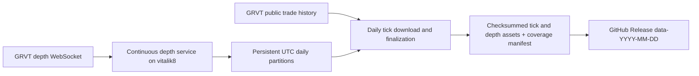

# GRVT daily tick and depth archive design

## Intent and current state

Requested: inspect the Apex historical-data setup, collect GRVT trades/ticks and order-book depth on **vitalik8**, and store the data as GitHub Release assets.

**Design status: approved by the user on 2026-10-16.** No collector, schedule, release, or production configuration has been installed or changed.

## Inspection evidence — 2026-10-16 UTC

| Check | Result |
|---|---|
| Execution host | Local hostname is `vitalik8`; Traycer also lists it as connected |
| Destination | `Ankvik-Tech-Labs/GRVT-Historical-Data`, private, default branch `main`; authenticated account has push/admin access |
| Existing GRVT implementation | Only `README.md`, initial commit `060a7ed` |
| Apex reference revision | GitHub HEAD `c1602f057b22b68caebde8109c269fcdc769143e` |
| Apex server configuration | Docker Compose defines continuous trades and depth services with persistent storage and restart policies |
| Apex server publishing | Publisher selects `--datasets trades`, sleeps 86400 seconds between runs, and does not select depth |
| Apex scheduled release | GitHub Actions workflow at 02:00 UTC, selects klines/funding/ticker; latest three runs succeeded |
| Apex latest release | `data-2026-10-16` contains no assets matching `trades` or `depth` |
| Apex on this host | No matching collector process, Docker container (including stopped), user service, or system timer found in inspected locations; this does not establish deployment state on other hosts |
| GRVT instrument probe | Keyless production `POST /full/v1/instruments`, active perpetual filter, returned 184 instruments, including equities |
| GRVT tick probe | Production `POST /full/v1/trade_history` returned BTC trades and a pagination cursor |
| GRVT depth probe | A 12-second BTC subscription to `v1.book.d` at 100 ms received 111 messages, starting with a sequence-zero snapshot containing 128 bid and 101 ask levels |
| GRVT trade-stream probe | Subscription acknowledged; received 50 initial trade snapshot messages. This short probe does not establish sustained live-trade coverage |
| Available storage | Approximately 119 GiB free on the host filesystem at inspection time; full-universe depth volume still needs measurement |

Reference code: [Apex Compose](https://github.com/tradingstrategy-ai/Apex-Historical-Data/blob/c1602f057b22b68caebde8109c269fcdc769143e/docker/docker-compose.daemon.yml), [Apex scheduled workflow](https://github.com/tradingstrategy-ai/Apex-Historical-Data/blob/c1602f057b22b68caebde8109c269fcdc769143e/.github/workflows/release-data.yml), [latest inspected release](https://github.com/tradingstrategy-ai/Apex-Historical-Data/releases/tag/data-2026-10-16).

## Selected approach

Use GRVT's historical trade API for the daily tick archive and run a continuous depth collector. GRVT documents three months of public trade retention and cursor pagination. Its depth delta feed supplies an initial full snapshot and subsequent price-level changes, with zero-size levels representing deletion. This gives daily ticks a recovery path while depth coverage starts with live capture.

| Option | Benefit | Cost / limitation |
|---|---|---|
| **Daily historical ticks + continuous depth — recommended** | Complete dated trade downloads can be retried; one persistent streaming subsystem | Ticks arrive in the archive after the daily job |
| Continuous trades and depth + historical tick reconciliation | Immediate local ticks as well as daily archives | Extra stream lifecycle and reconciliation machinery |
| Daily REST trades and sampled depth snapshots | Simplest runtime | Loses depth changes between snapshots; does not meet the proposed depth-history requirement |

Sources: [GRVT trade history](https://api-docs.grvt.io/market_data_api/#trade-history), [GRVT depth streams](https://api-docs.grvt.io/market_data_streams/#orderbook-delta).

## Collection contract

- **Universe:** all active GRVT perpetual instruments, including crypto and equities; automatically discover additions. Preserve instrument metadata and track instruments seen during each collection day so delisting does not erase that day's work.
- **Ticks:** actual public executions, preserving trade ID, instrument, venue, nanosecond exchange timestamp, price, size, and taker side. At 00:30 UTC, download the previous UTC day through all history pages. Deduplicate by instrument/trade ID; use explicit UTC bounds and filter the output to the target day. Resume failed dates and report failures per instrument.
- **Depth:** full aggregated L2 order book via `v1.book.d`, default 100 ms publishing interval. This archives the exchange's published feed; the rate is not a promise to observe every matching-engine transition.
- **Replay:** save the initial snapshot, ordered deltas, connection/session identifiers, sequence/previous-sequence values, and receipt timestamps. Sequence breaks trigger a new subscription and snapshot; record the unavailable interval. Produce a book checkpoint at UTC day boundaries so each daily archive can start replay without fetching an older release.
- **First day:** archive from activation onward; label depth before activation as unavailable. Start tick downloads from the activation date; older tick backfill remains a separate optional operation.

## Storage and publication

- Python package and CLI in this repo; Docker Compose for continuous collection and a host cron wrapper for the fixed UTC daily download/publish job, following the existing host's scheduling conventions.
- Stable deployment checkout at `/home/avik/GRVT-Historical-Data`; persistent runtime data under a dedicated GRVT data directory outside the implementation worktree.
- Append-only compressed raw depth segments, with atomic closure and daily normalized Parquet outputs for trades and depth. Preserve numeric strings and nanosecond integers without floating-point conversions. Package closed segments only.
- One release per **capture date**, e.g. `data-2026-10-16` published after 00:30 UTC on October 17. Assets named `grvt-trades-<date>-partNN.tar.gz` and `grvt-depth-<date>-partNN.tar.gz`, plus `manifest.json`. Split archives below 1 GiB.
- Manifest records instrument universe, requested and observed intervals, row counts, depth rate, outages, successful/failed tick downloads, hashes, schema version, and collector revision. A missing instrument or stream cannot be silently called complete.
- Serialize publication with a lock. Upload to a draft release, verify remote asset content hashes, then publish. Retries reuse verified assets; interrupted uploads remain recoverable. Corrections must retain already verified data.
- Keep GitHub releases indefinitely. Locally retain at least seven days of verified uploaded partitions; retain unpublished data until successful verification. Measure sustained disk use during rollout and surface low-space/upload failures through command failures, persistent logs, and a status command.
- Use host GitHub authentication for publication; keep credentials outside Git and outside the streaming collector's environment.

## Verification required before calling setup complete

1. Tests cover paginated trade downloads, UTC boundaries, deduplication, sequence breaks, snapshot recovery, day rollover/checkpoint replay, crash recovery, and retryable publication.
2. Live production smoke capture verifies trades and replayable depth for multiple instruments; a universe-wide run verifies subscription acceptance and actual coverage.
3. A dated release is uploaded, downloaded again, hash-checked, and inspected for both datasets and the coverage manifest. The activation day's partial coverage is explicit.
4. Confirm persistent service restart behavior, cron installation, daily command success, logs/status, and sustainable measured storage use on vitalik8.

## Approved scope

The user approved: **all active perpetuals; daily historical ticks; continuous full L2 depth at 100 ms; previous-day releases at 00:30 UTC; indefinite remote retention and seven days of verified local data.** Implementation has not started; implementation-plan review is next.
